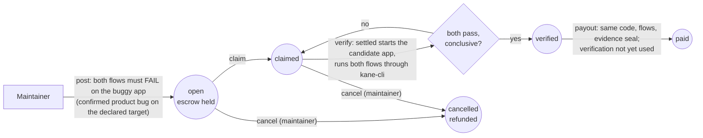

# Settled

**Bug bounties that pay out only when Kane CLI verifies the fix.**

A maintainer locks a bounty to two plain-English test flows. The escrow is released only when Kane CLI runs both flows against the solver's code and both pass, on fresh, sealed, replay-proof evidence. Kane CLI Online Hackathon entry; zero dependencies (Node ≥ 20 plus `kane-cli`).

> **Payments are simulated.** No real money or tokens move. See [Trust model and limitations](#trust-model-and-limitations).

## What you'll see

- **A half fix is caught:** the badge fix alone passes the locked flow, but Kane's guard flow sees **Charged $60.00 instead of $54.00**, and the payout is refused ([run 3](evidence/cart-badge-wrong/verify-20261124T173707Z-9237c2de)).
- **A live feedback loop (run 10):** an agent ran Kane first, saw that failure, fixed one line, passed `settled verify` and was paid, for **206.34 credits** ([evidence/autonomous-loop](evidence/autonomous-loop/README.md)).
- **The first autonomous run** (run 9) solved the bounty from one instruction for **147.38 credits** ([evidence/autonomous-sandbox](evidence/autonomous-sandbox/README.md)).
- **14 sealed evidence folders**, **896.94 Kane credits** of real runs, **52/52 unit tests**.

## Demo video

YOUTUBE_LINK

## Verify in one minute (0 Kane credits)

Clone the repo and run these. Nothing calls Kane; they re-check the recorded history and sealed evidence already in the repo.

| Command | Expected result |
|---|---|
| `npm test` | `tests 52`, `pass 52`, `fail 0` |
| `node cli/settled.js status cart-badge-wrong-v3` | `"status": "paid"`, events `posted`, `claimed`, `verify_passed`, `paid`; escrow `released` to `demo-solver` |
| `node cli/settled.js escrow` | `"USDC": {"deposited": 100, "balances": 100, "held": 0, "ok": true}`: deposited = balances + held |
| `node scripts/fingerprint.js cart-badge-wrong-v3` | `"match": true`, combined `c5bda0a8fd229c44e89b0928b3791f8da4123a3be540052189f96379ec1b7ffa` |
| `node cli/settled.js payout cart-badge-wrong-v3` | refused: `settled: cannot pay out: bounty is paid` (exit 1) |

## Try it with your own agent

Roughly **150–250 Kane credits** (runs 9 and 10 used 147.38 and 206.34).

1. Install `kane-cli` and log in: `kane-cli login --oauth`, then check with `kane-cli whoami`.
2. Clone the repo and make a sandbox, so the recorded history stays untouched:
   ```bash
   git clone git@github.com:defisensei-maxxing/settled.git && cd settled
   scripts/demo-sandbox.sh ~/settled-try && cd ~/settled-try
   node cli/settled.js post cart-badge-wrong-v3 --baseline evidence/cart-badge-wrong-v3/baseline-20261124T181329Z
   ```
   For a fair test, delete `patches/` and `docs/` in the sandbox first: they contain the fixes.
3. Open Claude Code in the sandbox and say: **"Claim bounty cart-badge-wrong-v3 and solve it using the Settled skill."** The skill in `.claude/skills/settled/` drives Kane and hands off to `settled verify`. Run `node cli/settled.js payout cart-badge-wrong-v3` yourself once verify passes.

## How the three bars are met

- **End to end:** post → claim → verify → paid with real Kane, three times: rows 8–10 in [the results table](#what-has-actually-been-demonstrated) (`evidence/cart-badge-wrong-v3/verify-20261124T181728Z-0c8e4100`, `evidence/autonomous-sandbox/`, `evidence/autonomous-loop/`).
- **Kane caught real bugs:** the half fix (row 3, `evidence/cart-badge-wrong/verify-20261124T173707Z-9237c2de`) and run 10's first guard run (`evidence/autonomous-loop/adhoc-runs/02-guard-baseline.*`), both Charged $60.00.
- **Closed loop:** an agent acted on Kane's failure, fixed it, and Kane verified the fix: `evidence/autonomous-loop/`.

---

## What it does in one picture



- **Locked flow:** proves the bug the bounty is for is fixed (the cart badge).
- **Guard flow:** a regression guard that must also pass (checkout must charge what the shopper saw). A half fix that passes the locked flow but breaks or ignores the guard is rejected. [We demonstrated exactly that](#what-has-actually-been-demonstrated).

## Architecture

```
cli/settled.js            CLI: post | claim | verify | payout | cancel | status | escrow
cli/lib/core.js           state machine + the rules for each command
cli/lib/ledger.js         append-only, hash-chained ledger per bounty (.settled/ledger/<id>.ndjson)
cli/lib/escrow.js         simulated escrow DERIVED from the ledgers; conservation checked on every write
cli/lib/evidence.js       evidence validation: conclusiveness, freshness, replay, seals, flow-text binding
cli/lib/fingerprint.js    settled-fp-v2: SHA-256 over locked flow, guard flow, and a combined hash
cli/lib/runtime.js        the only side effects: spawn kane-cli, start the candidate app
scripts/redact-evidence.js  scrub identity/tokens/paths from evidence, then seal with SHA256SUMS
scripts/demo-sandbox.sh   throwaway copy with the v3 bounty reset to draft, for live demos
scripts/run-flows.sh      manual: run both flows through Kane and save evidence
test/                     52 unit tests; Kane is MOCKED here and mocks are rejected by the CLI
.claude/skills/settled/   Claude Code skill: claim, iterate with Kane, hand off to settled verify
.settled/bounties/        bounty metadata + fingerprints     .settled/flows/  the flow texts
evidence/                 every real Kane run, redacted and sealed (links below)
patches/                  the solver's half fix and full fix, to replay the demo on the buggy shop
demo-shop/                target app with two planted bugs (plain HTML + Node, zero deps)
```

### How each guarantee is enforced

| Guarantee | Mechanism |
|---|---|
| **Kane is the only judge** | `verify` starts the candidate app itself (it refuses if the port is already taken, so a stale server can't stand in) and spawns `kane-cli run` for both flows. Solver-supplied results are never accepted. |
| **The test can't be softened** | `post` writes the combined fingerprint into the ledger. If a flow changes later, `verify` and `payout` refuse, even if someone re-pins the bounty file with `fingerprint.js --write`. |
| **The bounty is real** | `post` needs a baseline where **both** flows fail on the unfixed app with `assertion_error.confirmed_product_bug` **on their declared target check** (`baseline_expectations`). Setup checkpoints, agent errors and infrastructure errors don't count. |
| **The evidence is what Kane ran** | The objective in the Kane evidence pack must equal the locked flow text byte for byte. The session id must match the NDJSON stream, `run_end.json` must equal the streamed `run_end`, and `SHA256SUMS` must cover every file. |
| **No vacuous passes** | A pass needs `success.complete` / 100 and at least one recorded assertion. |
| **No replay** | Each Kane session can be used once across all ledgers. A verify run must start after its nonce is issued. Payout uses up one verification and needs the same app content hash, flows and evidence seal as at verify time. |
| **Tamper-evident state** | Every event is hash-chained. Each command replays the chain and refuses if an event was edited or removed, or if the bounty file disagrees with the ledger. |
| **Escrow conserves funds** | Escrow is computed from the ledgers: posted = deposit + hold, cancelled = refund, paid = release. Every write checks `sum(balances) + held == deposited` with no negative balances. `escrow.json` is only a snapshot and editing it moves nothing. |
| **No leaked identity** | Evidence is redacted before sealing: emails, usernames, user/org ids, report share tokens and local paths. |

## Install

```bash
git clone git@github.com:defisensei-maxxing/settled.git && cd settled
node --version                 # >= 20, no npm install needed
npm test                       # 52 unit tests, mocked Kane, no credits
kane-cli whoami                # real runs only; otherwise: kane-cli login --oauth
```

## Demo commands

**Zero-credit replay in a sandbox** (uses the recorded real baseline, then shows the refusals):

```bash
scripts/demo-sandbox.sh        # prints the exact commands; the core of it:
node cli/settled.js post   cart-badge-wrong-v3 --baseline evidence/cart-badge-wrong-v3/baseline-20261124T181329Z
node cli/settled.js claim  cart-badge-wrong-v3 --solver judge
patch -p1 < patches/half-fix.patch
node cli/settled.js payout cart-badge-wrong-v3     # refused: nothing verified
node cli/settled.js verify cart-badge-wrong-v3     # refused without --yes (it would spend credits)
node cli/settled.js escrow                         # conservation audit
```

A 3-minute storyboard for the submission video is in [docs/DEMO.md](docs/DEMO.md).

**Live Kane** (about 60–90 credits per verify):

```bash
node cli/settled.js verify cart-badge-wrong-v3 --yes   # half fix: locked PASS, guard FAIL
patch -p1 -R < patches/half-fix.patch && patch -p1 < patches/solver-fix.patch
node cli/settled.js verify cart-badge-wrong-v3 --yes   # full fix: both PASS
node cli/settled.js payout cart-badge-wrong-v3         # simulated 50 USDC to the solver
```

**Inspect the recorded history in this repo:**

```bash
node cli/settled.js status cart-badge-wrong      # v2: posted, claimed, 3 failed verifies, cancelled (refunded)
node cli/settled.js status cart-badge-wrong-v3   # v3: posted, claimed, verify_passed, paid
node cli/settled.js escrow
```

## What has actually been demonstrated

Every row is real `kane-cli` runs (kane-cli 0.10.9, Chrome, headless) with sealed evidence in this repo. Rows 1–8 are single runs; row 9 combines four and row 10 combines six.

| # | Run | Code under test | Locked | Guard | Credits | Evidence |
|---|---|---|---|---|---|---|
| 1 | v1 flows, original | buggy | ⚠️ passed (false pass) | ⚠️ passed (false pass) | 45.91 | [regression/v1-false-pass](evidence/cart-badge-wrong/regression/v1-false-pass-20261124T165309Z/REGRESSION.md) |
| 2 | v2 baseline | buggy | ❌ badge 2 | ❌ charged $60.00 | 94.14 | [20261124T171620Z](evidence/cart-badge-wrong/20261124T171620Z) |
| 3 | v2 verify, half fix | badge fixed | ✅ | ❌ charged $60.00 → **payout refused** | 89.26 | [verify-…173707Z](evidence/cart-badge-wrong/verify-20261124T173707Z-9237c2de) |
| 4 | v2 verify, full fix | both fixed | ✅ | ⚠️ Kane agent error, inconclusive | 56.64 | [verify-…175136Z](evidence/cart-badge-wrong/verify-20261124T175136Z-c47452ae) |
| 5 | v2 verify, full fix | both fixed | ✅ | ⚠️ setup run out of order, inconclusive | 68.27 | [verify-…175732Z](evidence/cart-badge-wrong/verify-20261124T175732Z-4b024942) |
| 6 | v3 baseline | buggy | ⚠️ Kane browser crash | ❌ charged $60.00 | 57.26 | [baseline-…180739Z](evidence/cart-badge-wrong-v3/baseline-20261124T180739Z) |
| 7 | v3 baseline | buggy | ❌ badge 2 | ❌ charged $60.00 → **posted** | 70.45 | [baseline-…181329Z](evidence/cart-badge-wrong-v3/baseline-20261124T181329Z) |
| 8 | v3 verify | both fixed | ✅ badge 3, $54.00 | ✅ charged $54.00 → **paid** | 61.28 | [verify-…181728Z](evidence/cart-badge-wrong-v3/verify-20261124T181728Z-0c8e4100) |
| 9 | **Autonomous agent** (sandbox), 2 practice runs + verify | agent's own fix | ✅ badge 3, $54.00 | ✅ charged $54.00 → **paid** | 147.38 | [autonomous-sandbox](evidence/autonomous-sandbox/README.md) |
| 10 | **Autonomous agent, Kane feedback loop** (sandbox, starts from the half fix): Kane first, then fix, then verify | half fix → agent's own fix | ✅ first run already passing; ✅ verify | ❌ **Charged $60.00** first, then ✅ charged $54.00 → **paid** | 206.34 | [autonomous-loop](evidence/autonomous-loop/README.md) |
| | | | | | **896.94** | |

What these runs show:
- **Kane's verdicts need guarding.** Run 1 passed buggy code: Kane looped until the lagging badge read 3 (4 shirts in the cart), and checked out an empty cart ($0 = $0). That is why flows use fixed click counts and absolute values, and why baselines must fail first.
- **A half fix is rejected** (run 3). The badge fix alone passed the locked flow, the guard caught the $60.00 overcharge, and the payout was refused.
- **Inconclusive runs never count** (runs 4–6). Kane agent errors, a setup checkpoint run out of order, and a browser crash were all rejected, never treated as passes or as bug evidence. Runs 4–5 led to flow v3 (unconditional setup) and to the tightened `post` rule. The original bounty was cancelled through the ledger and its escrow refunded.
- **The full fix gets paid** (runs 7–8). v3 failed on target against the original buggy app (content hash `ddece88f…`), passed against the fixed app (`fc1965ae…`), and 50 USDC (simulated) was released to `demo-solver`. A replayed payout is refused.

- **Autonomous repair through the Settled skill** (run 9). In an isolated sandbox with answer hints removed, a fresh Claude Code agent got one instruction: *"Claim bounty cart-badge-wrong-v3 as solver `settled-agent` and solve it using the Settled skill."* It was limited to 3 attempts and 300 credits. It diagnosed both bugs, fixed them in **one attempt** (two single-line changes), confirmed each flow with Kane, and passed `settled verify` (both flows `success.complete`, Charged $54.00) for **147.38 credits**. The maintainer checked the sealed evidence and code hash, then released the simulated 50 USDC. Details: [evidence/autonomous-sandbox](evidence/autonomous-sandbox/README.md).

**Limits of the autonomous result:**
- In run 9, Kane *confirmed* the agent's fix rather than steering it: the agent diagnosed from the bounty's recorded Kane failures plus reading the code, and no new run failed. **Run 10 closes that gap:** starting from the half fix, the agent ran Kane first, got the guard failure (Charged $60.00), fixed only the overcharge (one line), and passed verify, for 206.34 credits ([evidence/autonomous-loop](evidence/autonomous-loop/README.md)). The timestamps show the failure came before the code change. It was a single fail → fix → pass loop, and the same $60 failure is also visible in the bounty's recorded baseline.
- The bugs are easy: single-line, in a ~60-line app.
- The agent is the same model family that fixed these bugs earlier in the project (with no access to that conversation), and its fix is identical.
- Sandbox isolation was by instruction, not enforced.

Runs 1–8 had their fixes written by Claude Code under step-by-step human direction.

## Trust model and limitations

- **Simulated payments.** Escrow is bookkeeping derived from the ledgers. There's no wallet, chain or payment rail, and the reward is "deposited" at post time by assertion.
- **Single-machine trust.** The ledger, evidence and escrow are files in the repo. Hash chaining catches edits to *part* of the history, but whoever controls the repo can rewrite *all* of it consistently. The replay registry is per repository too, which is why `demo-sandbox.sh` can re-post the recorded baseline in a fresh copy. Production needs the ledger head anchored outside the repo (a signed append-only log, a transparency service or a chain), signed identities for maintainer and solver, and a verifier the solver doesn't control.
- **The verifier runs locally.** `verify` trusts the machine it runs on: the Kane binary, Kane's cloud judgment, and the app it starts. Identity is a name string; there's no authentication.
- **Kane is probabilistic.** A Kane run can end in agent or browser errors (runs 4–6). Settled treats those as inconclusive, which keeps it safe but can cost credits. Flows are written to be unconditional and explicit for that reason.
- **One port, one verifier at a time.** The flows hardcode `http://localhost:3000`.
- **The legacy v2 baseline** was posted with `--accept-legacy-baseline`, because it predates the `candidate.json` code binding (the demo shop was unchanged since `6cdc886`). The v3 baseline is fully bound.
- **Local account name in seven `REDACTIONS.json` files.** Before a later fix, the redactor wrote the evidence folder's absolute path, which includes the local macOS account name (not a credential). This includes the copied autonomous-sandbox verify folder. The files stay as they are, because the ledgers (the main ones, and the imported sandbox ledger for that folder) record each folder's seal hash (`sums_sha256`), and rewriting them would break the audit trail. New evidence records relative paths.

## Branches

- `main`: the submission. The demo shop has **both planted bugs** so anyone can replay; the fixes are in `patches/`.
- `demo/half-fix`, `demo/full-fix`: the history as it happened, with the fixed shop.

## Fingerprints

`settled-fp-v2`: `locked = sha256(trim(locked))`, `guard = sha256(trim(guard))`, `combined = sha256("settled-fp-v2\n" + id + "\n" + locked + "\n" + guard)`.

```bash
node scripts/fingerprint.js cart-badge-wrong-v3   # verify (exit 1 on mismatch)
```

v3 combined: `c5bda0a8fd229c44e89b0928b3791f8da4123a3be540052189f96379ec1b7ffa`
